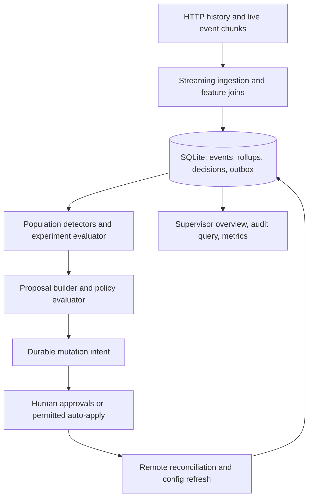

# Implementation plan: Outcome-First Agent Loop

Prepared 6 November 2026. This is a proposed implementation, not a report of completed functionality or measured results.

## 1. Interpretation and evidence

Build a durable, explainable controller that earns permission to optimise outbound calling. Do not turn this assignment into a general workflow engine, insurance claims platform, chatbot, or multi-agent framework. The job description provides architectural context; the assignment README and HTTP contract define delivery.

Reviewed: README.md, docs/SIMULATOR.md, all six stakeholder memos, SUBMISSION_TEMPLATE.md, examples/naive_controller.py, run.sh, Makefile, requirements.txt, and .gitignore. Inspected the development simulator through GET /sim/state, /workflows, /workflows/{id}/config and /openapi.json. The OpenAPI request schemas are mostly untyped dictionaries, so add local contract tests rather than assuming generated models will validate requests. Simulator internals, scenario truth and run-directory data were not used to design the controller. Existing simulator tests remain harness checks; controller tests must use independent API fixtures.

Company context: https://www.formi.co.in/ presents governed, auditable agents that finish banking and insurance workflows, use customer data, and involve humans in high-stakes decisions. That supports prioritising explicit authority, evidence and operational ownership. These are the company's published product claims, not independently verified certifications.

Important assignment facts:

- Primary business outcome: concluded leads / uploaded leads. Pickup = connected / dials; engagement = concluded calls / connected. Keep all three visible, and optimise each workflow's declared primary under its declared guardrail.
- The simulator's time advances only through POST /sim/advance, in multiples of 15 minutes. Controller restart does not restart the simulator.
- Allocations for welcome, voice and caller ID are independently sampled per dial. The controller cannot impose stable per-person experiment assignment through this API.
- `next_campaign_only` locks cohorts and allocations for each existing campaign. Prompt and schedule changes still take effect immediately.
- Every change, including exploration, promotion and rollback, needs approval or policy-permitted auto-apply.
- Baseline history is observational evidence. Permission denied, an approved but unapplied change, and an allocation that received no traffic provide no treatment outcomes.
- Do not modify sim/, read runs/ from controller code, import sim into the controller, parse scenario files from the controller, or hardcode public incident times, variant winners, workflow IDs or policies.

The live public_01 API returned the following policies. Treat this table as evidence for the submission, never controller constants; discover policy anew on every run and refresh before mutation.

| Workflow | Primary; guardrail | Auto-apply | Human hours; requests per rolling 24h | Mid-flight |
|---|---|---|---|---|
| nw_renewal | engagement; pickup drop <= 0.02 | schedule, caller_id; max shift 0.5 | 10–19; 3 | allowed |
| nw_kyc | pickup; engagement drop <= 0.02 | disabled | 10–18; 2 | cohorts/allocations next campaign only |
| ks_cancel | engagement; pickup drop <= 0.02 | schedule, caller_id, welcome_message, voice; max shift 0.2 | 10–19; 4 | allowed |

All three had a 2-hour approval apply window and minimum validation pass rate 0.97. Renewal/KYC proposal TTL was 24 hours; Kestrel's was 12. Kestrel's supervisor separately requests at most two requests/day and none before 11:00: honour this stricter preference while identifying it separately from enforced API policy.

## 2. Scope: five complete vertical slices

1. Durable HTTP ingestion, history bootstrap, shared cohort definitions and a queryable audit record.
2. Governance from evidence-backed proposal to reconciliation, application and supervisor explanation.
3. A narrow experiment loop: one agent dimension at a time, minimum evidence, promotion, monitoring and governed rollback.
4. Caller-ID degradation response using population evidence and a bounded exploration allocation.
5. Hallucination incident response: detect, suggest, validate, propose, apply, verify and protect engagement.

These reuse one store, policy evaluator, statistics layer and mutation path. Reliability is part of each slice, not a separate optional feature.

| Capability | Planned depth | Deliberate boundary |
|---|---|---|
| C1 ingestion | Core | Streaming, transactional batches, restart-safe progress and load benchmark |
| C2 joins/shared cohorts | Core, narrow | Existing cohorts plus a few supported feature cohorts; no Cartesian segmentation |
| C3 history | Core | Baselines, cohort support and initial caller-ID evidence; no invented counterfactuals |
| C4 call-time | Cut | Preserve business config; no per-person or cohort schedule optimiser in first submission |
| C5 caller ID | Core | Detection, policy-bounded rotation, monitoring; advanced contextual bandits cut |
| C6 welcome/voice | Narrow | Reusable one-factor engine; ship voice first, welcome only after reliability gates pass; interactions cut |
| C7 promotion/decay | Core | Retain reference traffic where safe; governed dimension-specific rollback |
| C8 hallucinations | Core | Workflow-wide prompt incidents, safety evidence, engagement verification |
| C9 governance | Core | Full lifecycle, stale bases, batching, hours, rolling limits, expiry, reconciliation |
| C10 proposal evidence | Narrow but honest | Historical exposure replay and observed lift; no causal estimate for unseen variants |
| C11 supervisor view | Minimal | Read-only consolidated API/JSON view; frontend cut |
| C12 audit | Core | Own-store evidence chain, timeline and customer-exposure lookup |
| C13 crash recovery | Core | Fault-injection plus real process kill/restart evidence |
| C14 observability | Minimal | Metrics, structured logs and an actionable runbook; monitoring stack cut |
| C15 fairness | Minimal | Tenant round-robin, reservations and bounded queues; global optimisation cut |

If time runs short, cut welcome experiments, new cohort activation and richer views before cutting governance, audit or recovery. Label reduced scope accurately in SUBMISSION.md. Do not advertise every capability as fully built.

## 3. Runtime and architecture

Use Python, httpx, SQLite from the standard library, and the supplied NumPy for statistical calculations. Reuse FastAPI only for a small optional read-only supervisor API. Pin versions actually tested. No LangChain, vector database, Kafka, Redis, Celery, or new database service for this assignment.

SQLite is a single-process implementation choice for a 4-vCPU/8-GB runner, not a claim that a local file is production HA. Use WAL, foreign keys, a busy timeout, durable synchronous settings, one writer and batched transactions. Benchmark before changing the storage design.



Suggested repository layout:

```text
controller/
  __main__.py       CLI, startup and orderly shutdown
  client.py         typed local API adapter, bounded retry/reconciliation
  store.py          schema, transactions and repository methods
  ingest.py         NDJSON ingestion, joins and incremental rollups
  cohorts.py        canonical ordered cohort definitions and matching
  statistics.py     rates, clustered uncertainty and planned tests
  experiments.py   experiment lifecycle and traffic proposals
  incidents.py     caller-ID, safety and decay detectors
  governance.py    policy checks, proposal lifecycle, batching and outbox
  loop.py           deterministic orchestration and simulator clock driver
  inspect.py       overview, why-change and exposure commands
  view.py          small read-only API, if time permits
tests/controller/  independent fixtures, fake HTTP service, fault injection
scripts/           scenario runner, crash test and benchmark runner
reports/           grade reports, benchmark JSON/Markdown, crash evidence
docs/RUNBOOK.md
SUBMISSION.md
run.sh
```

Avoid premature abstractions: these can begin as a few modules and split as ownership becomes clear. Keep the mutation boundary and transaction boundary easy to review.

`./run.sh <SIM_URL>` must launch the real controller, ingest history and continue until the run finishes without prompts. Use an optional `CONTROLLER_STATE_DIR` for stable persistence and a process lock to prevent two controllers driving the same world. Select an available Python/venv interpreter explicitly; this machine has python3 but no bare python. Do not install packages during a judged run. Document setup once.

## 4. Storage and ingestion

Persist at least these logical entities, combining physical tables where simpler:

- Run/checkpoint: scenario metadata, observed simulated time, history/live progress, schema/controller version. The API does not document a unique run ID; record the assumption that the simulator stays alive across controller restarts, and isolate independent runs in independent state directories.
- Chunks/events: chunk identity, resume offset/event boundary, event ID, type, timestamp, workflow and replayable payload. Unique event IDs within a run. Store raw payload compactly; avoid redundant large indexes and duplicate full call tables.
- Leads/campaigns: lead-to-person/features join, uploads, campaign creation version and distinct concluded lead accounting.
- Config snapshots: full config, version, observed actor/time, source proposal and approval IDs.
- Cohorts: stable ID, ordered predicate, definition version/hash and supported sample size.
- Rollups: bounded time bucket, workflow, cohort-definition version, actual config/variant, caller ID; dials, connected, engaged and flagged-connected counts. Do not materialise every possible feature cross-product.
- Experiments: intent, approvals, effective exposure epochs, planned samples/looks, alpha budget, arms, status and rollback fields.
- Decisions/proposals/outbox: evidence window, thresholds, code version, config diff, full proposed config, rationale, remote IDs and every transition.
- Incidents/credit operations: detected onset, response, cached validation, credit reservation, ambiguous paid requests, verification and closure.

Ingestion algorithm:

1. List history chunks and live chunks separately; their IDs share one global sequence. Never infer that `max(history)` means all live events have been processed.
2. Stream each chunk line by line. Commit bounded batches, initially 2,000–5,000 events, then tune from measurement.
3. In the same transaction, insert unseen events, perform feature joins, update rollups only for inserted events, and commit resume progress. Mark a chunk complete only after its final event commits.
4. On replay, unique constraints prevent counting an event twice. A partial chunk resumes or replays safely. Do not retain whole days of Python event dictionaries.
5. Missing feature joins remain explicitly unresolved and are repaired when the lead arrives. Do not silently assign unknown-feature calls to a feature cohort. Workflow-level incident counts can still be updated once.
6. Bootstrap history once. Track baseline age and config/prompt epochs; do not let old healthy days hide a recent incident.

Each loop iteration: reconcile remote state and pending mutations, drain known backlog, update detectors/evaluations, prepare and dispatch eligible work, then advance by 15 simulated minutes. After advancing, rediscover chunks even if `new_chunks` was lost. On finish, drain final events and reconcile remaining statuses; report unresolved requests honestly rather than pretending they applied.

Use simulated IST time for policy windows, evidence windows and request limits. Use monotonic wall time for performance measurements and HTTP retry deadlines.

## 5. Cohorts and experimentation

Start with existing workflow cohorts and a default population. Use history to select, at most, a few supported feature groups such as language; avoid age × language × city × value fragmentation. Initial eligibility threshold: 500 historical connected calls and 200 unique people for an engagement analysis, with a power-based threshold taking precedence. These are engineering starting points to validate, not universal guarantees.

One ordered cohort matcher must serve detection, experiment eligibility, dry-run exposure counting and the supervisor view. Snapshot its definition version with evidence. Record the API's actual cohort_id separately from analytical classification; a retrospective feature label does not prove a cohort allocation was active. Creating/changing cohorts itself needs governance and can require human approval even when voice changes may auto-apply.

Experiment protocol:

1. Read the workflow primary and guardrail. On pickup-primary workflows, prefer caller-ID opportunities before agent-voice experiments. Select only from advertised options and observable history/catalogue; names such as P3 or V4 have no built-in meaning.
2. Change one of voice or welcome at a time. Hold the other dimension fixed. Start with one challenger, or at most two when forecast exposure supports it; stable option ordering is only a reproducible tie-breaker, not evidence of quality.
3. Record the plan before traffic changes: control, challengers, allocation, practical effect threshold, sample target, comparison count, planned looks and stopping rule. Use a 50/50 control/challenger design where authority permits. If policy only permits smaller shifts, lower exploration or seek approval rather than chaining instant auto-applies to evade the limit.
4. Exploration begins only after actual application and observed calls. For next-campaign-only changes, use campaign creation versions and actual call variants, not the latest config alone.
5. Pre-plan a maximum of two information looks per experiment. Maintain a workflow-level family error budget, initially 0.05 across its predeclared experiment/comparison/look budget; use conservative Bonferroni allocation. No unbudgeted hourly winner tests. Reserve budget for later experiments rather than spending it all on the first challenger.
6. Size samples from baseline rate, minimum detectable lift, 80% target power and the adjusted significance level. For orientation, a 5 percentage-point effect around 50% needs about 2,000 independent observations per arm at one-sided alpha 0.01; repeated people and tighter correction increase that. Low-volume arms may finish inconclusive. A fixed `n=100` is not a defensible universal winner rule.
7. Compute ratios with their correct denominators and account for repeated calls to the same person using person-clustered ratio-estimator uncertainty. Require adequate independent-person support. Use NumPy/standard-library calculations and test them against synthetic null/alternative fixtures. The API randomises per dial, so do not claim person-randomised A/B testing.
8. Promote only if the primary lift lower confidence bound exceeds the chosen practical threshold AND the guardrail difference lower bound is above the negative allowed drop. An insignificant guardrail difference does not establish safety. Treat a zero denominator as insufficient evidence, never zero performance.
9. Retain a small reference allocation, initially 10–20%, when safe and permitted. Monitor drift on fresh epochs; roll back the owned dimension if degradation is sustained and supported. Apply the same governance checks to rollback.

Caller-ID changes, prompt edits and supervisor changes can confound agent experiments. Pause/restart affected evidence epochs; do not pool across them blindly. Independent simultaneous welcome × voice sampling does not establish a joint winning pair. Full factorial interactions and contextual bandits are explicitly out of scope.

The nominal family error budget relies on the test assumptions; clustered normal approximations do not provide an exact finite-sample guarantee. Report empirical false-winner rates from repeated synthetic null runs, along with sample support and the limitations of conditional engagement among answered calls.

## 6. Caller-ID, decay and hallucination response

Use common population detectors, with thresholds configurable and stored in each decision. Starter values below must be checked on synthetic no-incident data and normal public runs, without tuning to hidden truth.

Caller ID:

- Evaluate non-overlapping fresh windows, initially 60 simulated minutes, with at least 200 dials and enough unique people. Compare each ID against its own recent healthy baseline and contemporaneous other IDs, stratifying by material cohort/time composition where supported.
- Require a practically material pickup drop, initially 5 percentage points, uncertainty evidence and persistence across two windows. If traffic is insufficient, widen the window; do not diagnose from one bad call or one small cohort.
- Reduce a suspect ID toward zero only with a supported alternative, bounded exploration and policy permission. A max_shift limit may leave residual exposure; record residual risk and use approval for the larger desired change.
- Monitor pickup recovery and engagement guardrail after action. Avoid repeatedly rotating IDs during a platform-wide population change.

Decay:

- Store the winning/reference allocation, owned paths, promotion evidence and effective epoch.
- Compare fresh winner/reference outcomes and promotion baseline, excluding stale campaign exposure. Require practical degradation, adequate support and persistence; use hysteresis/cooldowns to avoid flapping.
- Reverse the controller-owned dimension against current config after a version/ownership check. Do not restore an entire old config over a supervisor's newer edits. A next-campaign-only rollback cannot immediately rescue existing campaigns; state that limitation.

Hallucinations:

1. Compute flagged connected calls / connected calls by workflow and prompt epoch. Initial trigger: at least 200 connected calls, at least 10 flags, a rise of at least 3 percentage points over baseline, uncertainty support and persistence. Treat flags as noisy safety signals, not verified hallucination truth.
2. Freeze new nonessential optimisation for that workflow. Preserve evidence and current supervisor context. Never invent a pause-dialling capability; cadence, capacity and dial windows remain business-owned.
3. Call suggest-fixes once for the incident epoch; store the request, result and cost. Deterministically rank suggestions by available evidence and catalogue description, not assumed option IDs.
4. Validate at most two candidates initially, n=500 each if credits allow, costing 5 credits each plus 3 for suggestion: 13 credits reserved. A validation pass must meet the workflow's threshold. Cache workflow/prompt/validation-context results; never pool validation runs or cherry-pick repeated borderline passes without recording it.
5. Attach the exact passing validation_run_id for the same workflow and prompt to the proposal. Record sample size and uncertainty; meeting the API threshold is not proof of zero risk. If neither candidate passes, expand only through an explicit reserved-credit decision; otherwise escalate visibly.
6. Prompt is workflow-wide; no per-cohort prompt canary is possible. After authorised application, evaluate fresh safety and engagement separately. Validation gives no engagement evidence. A safe but disengaging fix requires another governed decision, not silent acceptance.
7. Close only after sufficient post-change evidence, or keep status `mitigated_pending_evidence`. Preserve observed detection-to-proposal, approval delay, apply and verify times.

Repeated monitoring creates false-alert risk. Do not claim a repeated-window threshold has a global 1% false-positive rate. Measure false alarms per simulated day on null fixtures; distinguish safety action thresholds from statistically controlled winner tests.

Credit allocation: reserve incident capacity before optional work, charge all tenants through one ledger, use tenant round-robin for equal-severity work, and cache reusable evidence. If total budget cannot cover the nominal reserve for every workflow, prioritise by observed severity/exposure and surface the shortage. No speculative LLM calls in the normal optimisation loop.

## 7. Governance, proposals and honest impact

Local state machine:

```text
draft -> waiting_for_window/budget -> submitted/pending
pending -> approved | rejected | expired
approved -> applying -> applied | lapsed | stale | unknown_remote_result
stale/expired/lapsed -> refreshed evidence + fresh base + NEW proposal ID
unknown_remote_result -> reconcile -> observed terminal/current state
```

Every transition is stored, including why a proposal was deferred or declined. Expiry is an unsuccessful attempt requiring reassessment; preserve its distinct status rather than pretending it was a human rejection. Do not resubmit judgement rejections unchanged.

Before mutation, refresh workflow/config and compute changed dimensions, effective inherited allocations and total-variation distance (`0.5 * sum(abs(old_weight-new_weight))`) on normalised distributions for all affected cohorts. Adding cohorts is its own dimension. Use auto-apply only when every rule passes; no probing forbidden PUTs or using repeated tiny steps to bypass meaningful human review.

Otherwise route through /approvals. Submit during approver hours with enough time for expected latency and TTL; account for worst-case latency near closing. Poll pending approvals each tick and act promptly within apply_by. Maintain a rolling 24-hour request ledger, including requests whose response was ambiguous. Batch compatible changes, but keep an urgent safety fix separate from optional optimisation so it is not delayed. Reserve request capacity where feasible for incidents.

Supervisor changes: fetch actual config/history, invalidate stale proposal bases, suspend experiments whose assumptions changed, and prepare a fresh proposal that preserves unrelated edits. There is no documented cancellation API: locally supersede obsolete intent and never apply it if its approval later arrives. If an approval became stale, do not automatically merge away the conflict.

Proposal contents:

- Human summary: what changes, who hears it, expected benefit, uncertainty, risk and when it takes effect.
- Exact machine diff and full proposed config from the current base; source decision/evidence references.
- Affected leads: deduplicated known active leads matched by the changed configuration, respecting campaign-effective cohorts/allocations. The API does not expose exact remaining dial eligibility; distinguish an exposure estimate/upper bound from an exact eligible count. Show returning people separately and label projected future uploads.
- Dry run: replay cohort matching, overlap/order, allowed options, changed exposure shares, preserved dimensions, window validity and campaign timing against historical observed leads. It is an exposure/configuration replay, not an oracle for untried outcomes.
- Expected lift: observed estimate and interval when evidence exists; `unknown` for unseen treatments. Never manufacture lift from validation safety scores.
- Impact score in [0,1]: a documented priority index, not a success probability. For supported optimisation, use conservative primary lift scaled by workflow-relevant affected exposure. For safety work, use excess flagged exposure and severity on a separately labelled basis. Normalise against declared reference constants and show all components; do not hide uncertainty or blend pickup and engagement into one KPI.

The simulator may provide an approval ID but not the name of the approving human. Store actual identity fields if returned; otherwise say `simulated client approver; approval_id=...`. Do not invent named approval to satisfy a memo.

## 8. Crash safety and HTTP failure semantics

Persist a deterministic proposal ID and exact outbound body BEFORE sending a mutation. IDs should identify a durable intent, including workflow, base version and evidence epoch. One outstanding mutation owner per workflow.

| Failure | Behaviour |
|---|---|
| Chunk fetch disconnect | Replay chunk/batch; event IDs and transactional rollups prevent duplicate evidence |
| Approval response lost | Query approvals for the workflow and match proposal_id before resubmitting; 409 duplicate is a reconciliation signal |
| Apply/auto-apply response lost | Fetch current config/history and approval state; match proposal/base/version. Never blindly produce another intent |
| 409 stale base | Refresh config, reassess evidence/ownership and build a new proposal, preserving supervisor changes |
| 410 lapsed | Store terminal state, recompute urgency/evidence and seek fresh permission if still warranted |
| 403 auto-apply denied | Record policy mismatch, refresh policy and route a valid proposal through approval; do not hammer the endpoint |
| 402 credits exhausted | Stop paid work, retain monitoring/approval reconciliation and surface the safety response limitation |
| 400/422 | Audit validation/contract failure; do not retry malformed requests unchanged |
| GET transport/5xx | Bounded exponential backoff with jitter; no simulated advance while backlog/state is unknown |
| Mutation transport/5xx | Reconcile state before any retry because the side effect may have happened |
| /sim/advance response lost | Read /sim/state, compare to persisted pre-advance time and discover chunks; do not blindly advance again |

Paid suggestions and validation have no documented idempotency key or result-lookup endpoint. Exactly-once credit spend cannot be promised after a response-loss crash. Persist an `in_flight/unknown` reservation, consult credits_remaining, avoid automatic duplicate payment, and if evidence must be recreated make a bounded new operation from remaining reserved budget. A credit balance change cannot recover a lost validation_run_id. Document this API limitation and request idempotency/result retrieval for production.

Crash evidence must cover: during chunk ingestion, after approval POST before local acknowledgement, while waiting for approval, after remote apply before local commit, and during a supervisor conflict. Use a controllable fake API for precise ambiguous-response boundaries and at least one real simulator SIGKILL/restart integration run. Compare uninterrupted and recovered event totals, rollups, pending approvals and unique applied intents—not necessarily byte-identical remote stochastic outcomes.

## 9. Audit, supervisor view and operations

Provide commands such as:

```text
python -m controller.inspect --db <state.db> overview
python -m controller.inspect --db <state.db> why --workflow <id> --at <simulated-ISO-time>
python -m controller.inspect --db <state.db> exposure --lead <lead_id>
```

These should join evidence -> detector/test -> proposal diff -> approval/policy authority -> applied version -> actual exposed variants -> post-change measurements/rollback. Support actual calls by lead/person, not just workflow averages. Store event/config snapshots from HTTP so this works without simulator logs. Retain records for rejected and unapplied proposals while excluding them from treatment learning.

Minimal read-only overview API, if shipped: GET /overview, /workflows/{id}/timeline and /metrics, bound to localhost. One consolidated view shows primary/guardrail/business outcome, active tests, pending approvals, incidents, today's changes, credit availability and controller lag. No frontend or write controls are needed. Production authentication/RBAC is future work, not a claim of this local demo.

Metrics: event and chunk backlog, durable watermark age, ingest events/sec, per-stage processing time, decisions/hour, pending approval age, apply deadline slack, rejections/stales, primary/guardrail sample support, open incidents, paid/ambiguous credit spend, DB size and process RSS. Log stable workflow/cohort/experiment/proposal IDs.

Page for sustained ingestion failure, inability to meet an imminent apply deadline, unresolved harmful exposure without a permitted response, storage failure and unexpected repeated policy denial. Pending normal approvals, inconclusive experiments and routine rejections belong in the overview, not a pager. Each alert needs impact, identifiers and a runbook action.

## 10. Stakeholder decisions and draft replies

Use these as the basis of the six <=120-word replies in SUBMISSION.md, refining them to reflect what actually ships.

1. **Sales:** Accept a concise outcome story and fast action when supported. Refuse blended KPIs, unsupported same-day winners, cross-client prompt transfer and authority inferred from conversation. Reply: “I can show concluded-lead outcome alongside separate pickup and engagement. Verified wins can move quickly within each workflow's policy. KYC currently disables auto-apply; Kestrel excludes prompts/cohorts and limits allocation shifts to 0.2. We need evidence and the right approval before broader rollout. The demo will show both measured improvements and the audit trail, including inconclusive tests.”
2. **Compliance:** Accept human authority for customer-facing changes, evidence, exposure traceability and operational summaries. Do not promise zero temporary cohort harm or an approver identity the simulator does not expose. Reply: “Northwind customer-facing experiments and prompt changes will use client approval. Script proposals include same-workflow validation evidence, and timing/caller-ID auto-changes stay inside policy and appear in the summary. Our own records will trace each customer's observed variant to the applicable config and authority. We will keep changes bounded and monitor cohort harm, while being explicit that validation and statistical safeguards cannot guarantee zero risk.”
3. **SRE:** Accept demonstrated restarts, few dependencies, actionable alerts and measured scale. Reply: “The submission uses one controller process and SQLite, with a durable mutation outbox and replay-safe ingestion. It includes a kill/restart run plus tests around ambiguous responses and stale approvals. We will report controller-only and simulator-inclusive timings, memory, lag and events/sec. The production path uses the existing Postgres estate; Redis is optional. Paid API response loss remains a documented contract limitation until idempotency and result lookup exist.”
4. **Operations:** Accept preserving supervisor edits, two requests/day after 11 and one overview. Distinguish the stricter preference from API policy (10–19, four requests). Reply: “I will preserve your edits, batch compatible requests and cap human requests at two a day after 11. The enforced API allows a wider window and four, but we will use your stricter preference. The overview records intended and applied changes and their exposure. Safety validation does not prove engagement, so prompt fixes get post-change engagement checks. The simulator has no outbound notification acknowledgement, so production's ‘tell me first’ requirement needs a real notification/acknowledgement path.”
5. **Product:** Accept shared cohorts, separate KPIs, actual-exposure learning, honest proposals and workflow-local promotion. Decline all wishlists being P0. Reply: “The first version prioritises caller-ID health, a minimal consolidated view and an explainable approval/learning loop. Per-person call-time optimisation is cut because observational history and sparse returning-person data do not justify dependable personal recommendations in this timebox. Every learning record comes from actual exposure. Expired requests keep their own status and need fresh evidence before requeueing. Impact scores will expose their components and uncertainty rather than imply a probability of success.”
6. **CTO:** Accept scope discipline, low compute spend, scale evidence and ownership. Reply: “The implementation concentrates on five complete paths sharing durable state, statistics and governance. LLMs propose prompt candidates only during supported safety incidents; deterministic code chooses actions and winners. I am cutting scheduling personalisation, joint welcome/voice optimisation and UI polish. The submission includes measured load and recovery evidence, rejected alternatives, the remaining API limitations and a runbook another engineer can operate.”

Do not send these messages externally; they are submission content.

## 11. Implementation sequence and review gates

Target 16 hours across the available seven days. This is tight; reserve evidence-writing time and cut scope rather than silently exceeding it. Record actual hours.

| Order | Time | Work | Exit gate / natural commit |
|---|---:|---|---|
| 1 | 0.75h | Contract assumptions, scope matrix, setup and controller skeleton | run.sh can discover workflows and finish as a safe no-op; no simulator imports |
| 2 | 2.5h | SQLite, HTTP ingestion, history, joins and replay | duplicate/partial chunk replay produces identical counters; memory remains bounded |
| 3 | 2.5h | Policy evaluator, durable proposal/outbox, reconciliation and audit | auto limits, expiry, stale supervisor edits and ambiguous apply tests pass |
| 4 | 2.5h | Shared cohorts, one-factor voice experiment and governed promotion/rollback | deterministic tests, planned-look rules, actual-exposure and guardrail gates pass |
| 5 | 2h | Caller-ID and hallucination response, credit reservations | incident path attaches valid evidence, protects authority and verifies fresh outcomes |
| 6 | 0.75h | Overview/inspection commands, core metrics and runbook | explain one real applied change entirely from own DB |
| 7 | 2.5h | Public runs, grading, crash test and full-load benchmark | required reports/evidence exist; regressions fixed before optional additions |
| 8 | 2.5h | SUBMISSION.md, stakeholder replies, limitations and clean setup rehearsal | complete template, honest results, reproducible commands, review rehearsal |

Suggested calendar: days 1–2 establish the reliable floor; days 3–4 add learning and incident handling; day 5 run load/recovery; days 6–7 finish evidence, documentation and rehearsal. Use small honest commits at these gates; do not fabricate a retrospective history. Optional welcome-message support uses the same engine only if the gates pass early. Re-estimate after the first end-to-end run.

## 12. Verification and scale evidence

Correctness tests should target the real failure modes:

- Population thresholds, zero denominators, guardrail noninferiority and insufficient evidence.
- Cohort first-match ordering, inherited allocations and API-effective versus analytical cohorts.
- Actual variant/config/campaign attribution with next-campaign-only changes and immediate prompts.
- Duplicate chunks, partial transactions and missing lead joins.
- Total-variation boundaries, disallowed changed dimensions and full-config diff correctness.
- Approval duplicate, pending/rejected/expired/lapsed, rolling limits, approver windows and stale bases.
- Lost mutation responses, supervisor edits and safe dimension-specific rollback.
- No learning from an unapplied proposal and no repeated uncontrolled paid calls.
- Synthetic null/alternative experiment fixtures and repeated-monitor false alarms.

Integration harness, kept separate from controller code, may start sim, select scenario paths and run the official grader. The controller itself receives only the HTTP URL. Use independent baseline and candidate run directories for public_01/public_02. Generate official reports with `python -m sim grade`; inspect harmful as well as beneficial changes. Do not turn grade-labelled hidden headroom into controller inputs or tune to exact incident schedules.

For public_03, benchmark the complete five-day scenario and report bootstrap separately. Target the SRE request of <600 wall seconds per simulated day, and measure peak periods rather than only averages. The documented ~850k events/day means at least ~1,417 events/sec to process a day in ten minutes before allowing simulator and decision overhead; target >=5,000 events/sec for the ingestion component as an initial engineering objective, not a measured result. Streaming/chunk replay needs to cope with large history chunks too.

Report hardware/OS/Python, event counts, batch size, raw/decoded throughput, ingestion CPU/wall time, decision lag p50/p95/max, tick time, peak controller RSS, DB/disk size, simulator time, overall time/day, approvals and credit spend. Decision lag must include configured evaluation cadence, backlog delay and decision computation; separate human approval delay. Because simulator time waits for the controller, a zero simulated backlog lag alone is not a production latency benchmark. Include a paced/replayed API-event test if time permits; otherwise state that limitation. Measure simulator and controller processes separately.

At 10x, likely pressure points are NDJSON parse/serialization, SQLite write/index/retention cost, history replay and cardinality of person-level experiment statistics; establish which from measurements. A 10x ten-minute target would require ~14,167 events/sec before other overhead. Do not claim it passes without running it.

Production evolution: replace local state with existing Postgres, partition event data/time-series rollups, use transactional outbox/job claiming, serialise mutations per workflow with leases/fencing, and partition processing by tenant/workflow. Keep tenant quotas and incident priority. Add a durable event broker only if replay/backpressure requirements exceed existing infrastructure. Redis may accelerate caches; it must not be the only record of approvals or evidence.

## 13. Final deliverables and interview preparation

Deliver controller source, a functioning run.sh, tested dependency pins/setup instructions, complete SUBMISSION.md with all original headings, public_01/public_02 grade reports, public_03 benchmark evidence, crash script/log, and a runbook. Keep simulator files unchanged. Add local controller state to .gitignore; never commit runtime DBs or huge runs. Keep the assignment and solution private as required.

SUBMISSION.md must contain actual figures, one real incident timeline, one real audit query/output, measured false-winner/false-alert evidence where available, observed harmful changes, every scope cut and every assumption. Do not fill result sections with planned numbers or unverified success claims. Optional video: <=5 minutes, demonstrating one change and its evidence.

Prepare to explain live: why a specific hidden-run change happened; which population/denominator supported it; its authority; what happened afterward; why the guardrail was considered safe; what survives a crash; why a supervisor edit was preserved; how policy changes affect the design; why per-person call timing was cut; and what bottleneck measurements imply for 10x.

First two production weeks: validate policy ownership, identities, telemetry quality and KPI definitions; shadow the controller with no mutations; add service authentication/RBAC, retention and tenant isolation in existing infrastructure; obtain paid-operation idempotency and real notification/approval integration; exercise recovery and runbooks; enable one low-risk tenant/workflow with explicit approval; then expand only with exposure, guardrail, lag and incident evidence.
