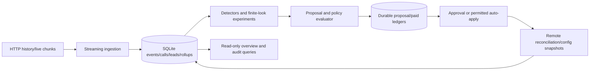

# Outcome-First Agent Loop — Submission

**Name:** Anmol Lamba · **Date:** 7 November 2026 · **Hours actually spent:** Approximately 4 hours (estimated; AI-assisted implementation, testing and review) · **Language / storage:** Python / SQLite WAL

## 0. TL;DR

HTTP-only controller with restart-safe ingestion, shared cohorts, governed experiments, caller-ID quarantine and validated prompt incident response.
Public_01 concluded-lead rate improved 0.8% relative to baseline; public_02 improved 5.5% in the final recorded runs.
Public_02 used 8/200 credits; the prompt fix took 1,590 simulated minutes from the supervisor edit, including approval delay.
A real SIGKILL/restart recovered a pending approval with no duplicate applications and a complete event watermark.
Per-person timing, joint welcome/voice optimisation, a polished frontend and production notification delivery are cut.

## 1. Assumptions

1. The HTTP contract, not stakeholder recollection or public scenario truth, defines authority. Controller code imports no simulator modules and reads no scenario files or simulator output.
2. Event IDs strictly increase globally. Ingestion merges history/live chunk listings before processing; it never commits a later chunk past an unfinished earlier one. IDs need not be contiguous.
3. Controller restarts reuse a state directory and a still-running simulator world. A new world uses a new state directory. The API supplies no unique run UUID; a backwards clock fails explicitly.
4. One driver owns a simulator. The local process lock protects a state directory, not different directories pointed at the same world. Production needs leases/fencing.
5. All policy times are simulated IST. Wall-clock monotonic time is used for performance and retry delays.
6. History is observational baseline evidence. Synthetic prompt validation measures safety, not engagement. No outcomes are inferred for unapproved or unexposed variants.
7. Normal confidence approximations need independent-person support and representative assignment. Repeated calls are clustered by person. The API randomises per dial, not per person.
8. We can estimate campaign-age-qualified, unconcluded exposure, but exact remaining attempt/gap eligibility is not exposed. Affected-lead counts are labelled upper bounds; historical dry runs are exposure replays, not counterfactual outcome predictions.
9. Client preferences can be stricter than policy. Kestrel's two requests/day after 11:00 and human review for agent changes are separate preference data. There is no simulator notification-acknowledgement API or emergency pause-dialling API.
10. The approval API exposes an approval ID but no guaranteed named human identity. Records identify the simulated client approver and preserve returned approval details without inventing a name.
11. Paid endpoints have no documented idempotency or result lookup. Lost paid responses retain an unresolved reservation and visible incident; exactly-once credit spend cannot be guaranteed by this client.

## 2. Scope decisions

| # | Capability | Built / Partial / Cut | Why | What it would take to finish |
|---|---|---|---|---|
| C1 | Durable load ingestion | Built | Core correctness and scale floor | Production event transport/retention |
| C2 | Feature joins/shared cohorts | Built, narrow | One supported language cohort plus default; honour existing cohorts | More segmentation only after power checks |
| C3 | History bootstrap | Built | Baselines and cohort support before D0 | Faster precomputed feature aggregates |
| C4 | Call-time optimisation | Cut | Sparse per-person evidence and selection bias; business capacity must remain intact | Randomised scheduling protocol and exposure analysis |
| C5 | Caller-ID health | Partial | Detection, rotation, quarantine and verification built | Controlled re-entry/probing of quarantined IDs |
| C6 | Welcome/voice experiments | Partial | Both single-dimension modes exercised end to end; not a joint optimiser | Joint interaction design and broader effectiveness evidence |
| C7 | Promotion/decay rollback | Partial | Finite-look promotion exercised in the public_03 load run; reference-based rollback implemented/tested | Adverse decay through approved rollback still needs end-to-end evidence |
| C8 | Hallucination response | Built, bounded | Suggest, validate, approve, apply and verify; escalate if unsafe or ambiguous | Production incident routing and alternative-fix recovery after engagement harm |
| C9 | Governance | Built, narrow batching | Lifecycle, hours, rolling limits, stale bases, reconciliation and new-ID successors | General multi-intent batching/notification acknowledgement |
| C10 | Proposal evidence | Built, bounded | Honest exposure upper bounds, exact diffs, transparent priority index | Better eligibility API and causal estimates where supported |
| C11 | Supervisor view | Partial | Consolidated read-only API/CLI | Authenticated UI and notification integration |
| C12 | Own audit store | Built | Review questions can be answered without simulator logs | Production retention/access controls |
| C13 | Crash recovery | Built | Real pending-approval SIGKILL plus precise fault tests | Multi-node failover exercises |
| C14 | Observability | Partial | Persisted metrics, structured logs and runbook | External dashboards, alert delivery and SLOs |
| C15 | Tenant fairness | Partial | Tenant round-robin and bounded paid response | Per-tenant guaranteed budgets and admission control |

I chose five connected paths that share state and authority: durable evidence, governance/audit, one-factor experimentation, caller-ID response and prompt safety response. Scheduling personalisation and presentation polish would dilute the reliability and evidence needed to defend the loop.

## 3. Stakeholders

### 01 — Sales

Accepted a compact outcome story and prompt action when evidence/authority permit. Declined blended KPIs, unsupported lunchtime winners and cross-client prompt transfer. Wrong claims: Northwind KYC disables auto-apply; Kestrel excludes prompts/cohorts and caps allocation shifts at 0.2.

**Reply:** I can show concluded-lead outcome alongside separate pickup and engagement. Verified changes can move quickly within each workflow's policy. KYC currently disables auto-apply; Kestrel excludes prompt/cohort changes and limits allocation shifts to 0.2. The persuasive prompt needs same-workflow safety validation and client permission. The demo will show measured improvements, uncertainty and the audit trail. An inconclusive test will remain inconclusive rather than becoming a marketing win.

### 02 — Compliance

Accepted human authority for customer-facing Northwind changes, validation evidence, policy-bounded operations and customer exposure lookup. Did not promise zero temporary harm or fabricate named approvers. Memo hours match the public development policy; renewal and KYC have different primary KPIs.

**Reply:** Northwind customer-facing experiments and prompt changes use client approval. Script proposals attach validation for the same workflow and prompt. Timing/caller-ID auto-changes stay within discovered policy and appear in the audit overview. Our records trace each observed customer variant to its config and authority. Validation and statistical safeguards reduce risk but cannot guarantee zero cohort harm. The simulator supplies approval IDs rather than guaranteed human names; production must bind those IDs to your identity system.

### 03 — Platform/SRE

Accepted demonstrated restart recovery, few dependencies, measured scale and actionable diagnostics. SQLite avoids a new operated service for this exercise; it is not production HA. Pushed back on exactly-once guarantees for paid APIs without server support.

**Reply:** The controller uses one process and SQLite with replay-safe ingestion and a durable mutation ledger. Evidence includes a real kill/restart with an approval pending, plus tests for lost responses and stale supervisor edits. Load reports distinguish ingestion throughput, simulator overhead, decision cadence and memory. Production persistence moves to the existing Postgres estate with workflow fencing. Paid-call response loss needs idempotency and result lookup from the API; until then it stays visible and is never blindly repaid.

### 04 — Kestrel operations supervisor

Accepted preserving edits, two requests/day after 11:00, one overview and separate safety/engagement verification. The enforced policy is actually four requests, 10:00–19:00; client preference is stricter. There is no outbound notification acknowledgement in the simulator.

**Reply:** I will preserve your edits, batch the initial cohort/allocation change and cap human requests at two per rolling day after 11:00. The API allows four and starts at 10:00, but we use your stricter preference. Agent changes voluntarily use human review. One overview records intended and applied changes and their exposure. Prompt validation cannot prove engagement, so fixes get fresh outcome checks. Production's “tell me first” requirement needs a real notification/acknowledgement integration; a local record alone does not satisfy delivery.

### 05 — Product

Accepted separate KPIs, one cohort matcher, actual-exposure learning, workflow-local changes and transparent proposals. Declined per-person scheduling as P0. Expired is unsuccessful for product purposes but remains a distinct lifecycle state, not a fabricated human rejection.

**Reply:** The first version prioritises caller-ID health, the consolidated operational view and an explainable approval/learning loop. Per-person call-time optimisation is cut because sparse observational history cannot establish dependable personal recommendations in this timebox. All treatment evidence comes from actual exposure. Expired requests retain their status and require a fresh proposal/base before requeueing. Impact scores expose severity, observed exposure and uncertainty rather than imply a success probability. Pickup and engagement remain separate in the view and the tests.

### 06 — CTO

Accepted explicit cuts, low compute spend, measured scale and ownership documentation. No policy contradiction in this memo; its warning to verify other memos was justified.

**Reply:** The implementation concentrates on five paths sharing durable evidence, deterministic statistics and governance. LLMs suggest prompt candidates only during supported safety incidents. I cut scheduling personalisation, joint welcome/voice optimisation and frontend polish. The submission includes load/recovery evidence, harmful as well as beneficial changes, rejected alternatives and a runbook. Production priorities are authoritative identity/policy integration, durable event ownership, paid-operation idempotency and shadow-mode validation before enabling a client workflow.

## 4. Architecture



Modules separate HTTP, ingestion/storage, pure cohort/config rules, statistics, experiments, incidents, governance and orchestration. SQLite WAL with synchronous=FULL commits each event batch, its materialisations and its watermark atomically. A durable intent precedes each remote mutation. On restart the controller discovers outstanding chunks, reconciles remote approval/config history and resumes without resetting learned state or spent statistical looks. See docs/CONTROLLER.md and docs/RUNBOOK.md for commands.

## 5. The learning loop

**Cohorts:** Existing ordered cohorts are respected. For an unsegmented workflow, history can justify one language cohort (>=1,000 historical connected calls and >=200 observed people), plus default. Each experimental population requires >=500 historical connected calls. The same model.Cohorts matcher serves formation, dry-run counting and the view; actual call cohort IDs and definition/config epochs determine treatment attribution. No feature Cartesian product is built. This improves interpretability at the cost of missing age/language interactions.

**Experiment:** One configured agent dimension per workflow/run, voice by default. Keep 50% reference allocation and distribute the remaining 50% across advertised challengers. Exploration itself is a governed change, and begins only on application. Independently sampled welcome/voice weights cannot establish a winning joint pair; joint effects are cut. The Python CLI can run welcome instead of voice, but the default evaluation exercises voice.

**Winner:** Predeclare two information looks at N and 2N per arm. N uses historical rate, 80% target power, 15pp design MDE and Bonferroni alpha = 0.05 / (two looks × challengers × experimental cohorts), with a minimum 200 observations. This intentionally detects large effects first. Use the actual primary denominator, >=100 supported people per arm and person-clustered ratio-estimator standard errors. Promote only when the primary lower bound exceeds +1pp AND the guardrail lower bound exceeds minus the policy drop. No significant harm is not proof of noninferiority. Ties are deterministic. Spent looks/alpha survive restart and epoch changes. Recommendations can be re-proposed without another statistical test.

**Calibration:** reports/statistical_calibration.json records 200 trials/case with repeated-person effects, three challengers and two looks: 1/200 null full passes (0.5%); 125/200 supported positive-effect full passes (62.5%); 0/200 full passes under a 15pp pickup harm. Primary-only positive power was 100%; the stricter guardrail costs power. This is fixture-specific asymptotic calibration, not an exact production error guarantee. Public_01/02 remained inconclusive for winner promotion; public_03 established one promotion. Exploration is not labelled a win.

**Decay/rollback:** Promoted allocations keep 20% reference traffic. Non-overlapping 12-hour blocks require supported negative lift in two blocks before governed rollback. Early experiment harm is checked separately every six hours. Restore only the owned allocation dimension against current config. A prompt/caller-ID change starts a fresh evidence epoch without refreshing alpha. Supervisor changes to the experiment dimension/cohorts invalidate it. Public_03 promoted V4 on arav_cancel_2 at minute 2,115 and recorded seven decay checks, none adverse (the first lacked enough fresh evidence). An actual adverse decay through approved rollback remains unexercised end to end; a repeated-window rollback and preserved-prompt regression test exercises the decision path.

**Call time/caller ID:** Timing is untouched. Caller-ID detection compares matching hours against history/recent prior days and peers where available. It requires >=200 fresh dials, >=400 baseline dials, a 3-SE drop and two distinct two-hour windows. Minimum practical drop is 5pp with peer support and 10pp without it. Rotation uses advertised alternatives; quarantined IDs cannot be silently reintroduced. Recovery checks are descriptive and can be superseded by another config epoch.

## 6. Governance

Local intent flows through draft -> sending/pending -> applying -> applied, with rejected/expired/lapsed/stale/superseded/blocked outcomes preserved. `approved` is observed from the remote API and committed with the applying transition/approval details before mutation. Unknown send/apply results retain a reconcileable intent. Stale/expired successors receive a new proposal ID, latest base and rebuilt exposure data; original authority is never reused. Same-config judgement follow-ups require a cooldown and >=200 newly answered calls; unapproved outcomes are never claimed.

Human requests use discovered approver hours, rolling limits and maximum latency to avoid late submissions. Kestrel's stricter preference wins. One active intent per workflow simplifies serialisation; compatible cohort/allocation setup is one request, and urgent incidents supersede optional work. General queue batching is cut. Obsolete remote approvals cannot be cancelled by this API, so they are locally superseded and never applied.

Auto-apply requires every changed dimension to be allowed and every effective, inherited, normalised distribution's total-variation shift to be within max_shift. Cohort creation is checked separately. No sequence of tiny mutations bypasses a larger approval boundary. Kestrel agent changes voluntarily require human permission. Public_01/02 used human approvals; auto-apply and its ambiguous response recovery have unit evidence rather than a claimed public success.

Each proposal stores its summary, full config, exact diff, evidence, campaign-age-filtered unconcluded exposure upper bound, distinct people and cohort replay. Exact remaining attempts/gaps and untried treatment outcomes remain unknown. The impact score is an explicit queue-priority index: severity or conservative observed lift × (0.5 + 0.5 × exposure fraction), capped to [0,1]; its components are in the dry run. It is neither a success probability nor a blended KPI.

Supervisor edits refresh actual policy/config and end contaminated evidence epochs. An old full config is never blindly replayed. Config history is useful for commit reconciliation but does not expose every old config body; snapshots observed through HTTP and actual per-call variants are retained in our own store.

## 7. Incidents

Safety detection uses current-prompt-epoch counts: >=400 connected calls, >=10 QA flags, a >=3pp increase over historical flag rate and >3-SE evidence on two checks separated by >=200 newly answered calls. These checks overlap; there is no claimed global false-alert probability. Flags are imperfect labels. The no-incident public_01 run produced zero incident records across 24 workflow-days, a small and non-independent validation sample, not proof of zero false alarms.

On detection, suspend optional optimisation; suggest once, validate at most two candidates at n=500, and attach a passing same-workflow/prompt validation ID. Reserve 13 credits for suggestion plus two validations; the observed fix needed 8. Unknown paid results stop blind retries and remain visible. If a safe fix degrades engagement, mark needs_review rather than restoring an unvalidated unsafe script. No unsupported emergency dialling pause is invented.

Recorded public_02 timeline (IST; D0 = 4 January 2027):

| Event | Time | Evidence/authority |
|---|---|---|
| Caller ID flagged by world | D2 10:00 | Official grade onset; never a controller input |
| Controller detects caller degradation | D2 14:00 | D2: 36/403 pickups versus historical 1,791/6,347; peer D1 120/397 |
| Rotation applied | D2 15:30 | Human approval; quarantined ID has zero traffic from D3 onward in grade report |
| Caller-ID recovery recorded | D2 19:00 | 273/1,200 pickups after rotation versus 156/800 before; no detected engagement deterioration |
| Supervisor changes prompt | D3 11:30 | Observed config_changed event; preserved as its own authority |
| Safety detection, validation and request | D4 13:00 | 57 flags / 1,130 connected versus 225/16,439 baseline; validated pass 0.988 on 500 |
| Prompt fix applied | D4 14:00 | Same-workflow validation and human approval; onset-to-fix 1,590 min |
| Verification recorded | D4 17:00 | 4 flags / 220 connected; engagement 112/220; no supported deterioration detected |

The official traffic-share report independently shows the suspect ID remained removed. Safety verification is not an engagement noninferiority proof. Of the 1,590-minute prompt-fix delay, 1,530 minutes elapsed before detection and 60 minutes between detection/request and application. The detector's sustained-evidence gates reacted slowly in this trajectory; detection latency needs calibration on representative incident traffic. Faster emergency mitigation also needs explicitly delegated authority.

## 8. Scale

The complete five-day public_03 run processed 9,737,474 events: 5,537,379 historical plus 4,200,095 live/control events. See reports/public_03_metrics.json and reports/public_03.md.

| Measure | Recorded result |
|---|---:|
| CPU allocation | Four-core Linux affinity; host exposes 16 CPUs |
| Ingest throughput (HTTP/parse/store/rollups, including bootstrap) | 32,921 events/sec |
| Controller bootstrap wall time | 177.60 s |
| Simulator history generation/startup | 46.91 s |
| Full controller-driven five days, including controller bootstrap and simulator advance time | 402.27 s |
| Mean per simulated day, amortising controller bootstrap | 80.45 s |
| Day processing excluding bootstrap | 58.66, 43.81, 36.77, 40.29, 44.79 s |
| First day including both simulator and controller bootstraps | 283.18 s; below the 600-second target |
| Peak controller RSS | 126,872 KiB (123.90 MiB) |
| Sampled combined simulator/controller RSS | 584,832 KiB (571.12 MiB) |
| Event-to-decision simulated lag p50 / p95 / max | 30 / 58 / 60 min |
| Maximum decision-cycle wall time | 11.85 s, dominated by initial history/cohort work |
| SQLite DB size | 2,184,712,192 bytes |
| Final integrity / duplicates / missing feature joins | ok / 0 / 0 |

All load measures separate controller RSS from sampled combined RSS. Four-core affinity is imposed; an 8-GB cgroup limit is not. The simulator waits while the controller computes, so simulated event-to-decision lag is a cadence/evidence-freshness measure, not a paced production-stream latency benchmark. The latter is not built. Full history bootstrap is measured separately from day processing.

At 10x the documented event envelope, the ten-minute target requires roughly 14,167 events/sec before other work. Current measured ingest headroom alone cannot establish a 10x end-to-end pass. Initial raw-history joins, person-level comparisons, growing SQLite indexes and long-term event retention are growth costs. Partition by tenant/workflow with serial mutation ownership and time-partitioned events/rollups in existing Postgres. Use transactional outbox/job claiming and fencing. Keep Redis optional and non-authoritative; add a broker when replay/backpressure requirements justify its operational cost.

## 9. Reliability

reports/public_01_metrics.json records a real SIGKILL (-9) while an approval was pending, followed by restart against the same world and state. It finished with SQLite integrity `ok`, no unjoined calls, zero duplicate local application records, no pending remote-intent states, and a final event watermark equal to the HTTP source. The persisted pending proposal/approval IDs survived. Precise unit fault injection additionally covers response loss after remote submission/application, supervisor edits before recovery, partial ingestion failure and unresolved paid calls.

Proposal IDs are durable before send. Approval duplicates trigger lookup, not rejection; remote commit history reconciles an apply whose acknowledgement was lost. Ingestion materialisations and watermarks share a transaction. Lost /sim/advance responses are followed by state/chunk discovery rather than a blind second advance.

GET/server failures use bounded backoff; mutation failures reconcile before retry. 409 stale ends the attempt; 410 preserves lapse; 403/400/422 become visible blocked/contract failures; 402 stops paid work. Paid response loss cannot be made exactly once without API support. A killed process can lose its current uncommitted batch and log/partial timing observations, which replay; committed learning, pending authority and evidence remain durable. SQLite does not protect against losing the machine/disk.

## 10. Audit & observability

The inspect CLI and local API read our SQLite store, not simulator files. For example:

```bash
python -m controller.inspect --db .controller-state/review_incidents_v1/state.db why \
  --workflow ks_cancel --at 2027-01-08T14:00:00+05:30
```

Recorded output is in reports/public_02_audit.json. Its essential chain is: sustained QA rise -> validation val_00001, pass rate 0.988 on 500 conversations -> stored full prompt diff and exposure replay -> client approval -> applied version 5 -> incident verification. Full raw IDs/approval details and descriptive before/after windows are preserved in the JSON. For an exact supervisor edit, the command identifies the supervisor and explicitly reports rationale as unavailable. Exposure queries show actual call variants and separate prompt authority from campaign-locked agent config.

Excerpt from that actual query output:

```json
{
  "id": "ctl_3f52058c8dc141cbb6d5aa8957dfa93f",
  "kind": "hallucination_fix",
  "status": "applied",
  "base": 4,
  "approval": "apr_00005",
  "updated": 6600
}
```

Metrics include event/chunk progress, ingest time/throughput, decision counts/duration, weighted simulated lag histogram, RSS, current credits, paid operations, pending proposals and incidents. Page on sustained ingestion/storage failure, imminent missed apply authority, unresolved harmful exposure or repeated unexpected policy denial. Routine pending approvals, rejections and inconclusive tests stay in the overview. External page delivery is not implemented; docs/RUNBOOK.md gives actions.

## 11. Results

These percentages are the official grader's relative changes; they are not percentage-point lifts or causal estimates from experiments. Full reports include governance, incident and harmful-change detail.

Public_01:

| workflow | conclusion rate | Δ | pickup | Δ | engagement | Δ | engagement gap captured | hallucinated calls (base) |
|---|---|---|---|---|---|---|---|---|
| ks_cancel | 0.345 | +3.5% | 0.240 | +0.8% | 0.501 | +2.2% | 10% | 51 (47) |
| nw_kyc | 0.360 | -0.9% | 0.241 | -0.5% | 0.588 | -0.4% | 0% | 27 (21) |
| nw_renewal | 0.415 | -1.1% | 0.261 | -0.8% | 0.544 | -0.3% | 1% | 49 (42) |
| ALL | 0.372 | +0.8% | 0.248 | -0.0% | 0.533 | +0.6% | 4% | 127 (110) |

Public_02:

| workflow | conclusion rate | Δ | pickup | Δ | engagement | Δ | engagement gap captured | hallucinated calls (base) |
|---|---|---|---|---|---|---|---|---|
| ks_cancel | 0.290 | +17.1% | 0.203 | +10.4% | 0.501 | +5.1% | 35% | 94 (330) |
| nw_kyc | 0.389 | +3.9% | 0.248 | +2.6% | 0.597 | +0.8% | 0% | 33 (31) |
| nw_renewal | 0.415 | -2.8% | 0.260 | -0.8% | 0.538 | -1.9% | 0% | 53 (55) |
| ALL | 0.353 | +5.5% | 0.231 | +4.2% | 0.535 | +0.9% | 14% | 180 (416) |

Public_01 applied two changes: one beneficial and one neutral; one request was rejected by judgement. No harmful change was applied. Both voice experiments remained inconclusive. Public_02 applied four changes: two beneficial, one neutral, one harmful. Initial Northwind exploration was harmful under hidden truth, even though permission was valid; bounded exploration can still have real cost. The caller-ID and prompt fixes were beneficial. No applied change bought lift by bypassing governance.

Untouched workflows also differ from baseline across simulator trajectories. Do not attribute every aggregate delta to a specific action. Public_01/02 produced no expired/lapsed attempts or auto-apply denials; expiry/lapse/auto recovery have test coverage. The next statistical improvement is a predeclared, adequately powered cohort experiment with a lower design MDE and explicit exploration cost. Reverting after an inconclusive test can discard a beneficial mixed allocation: inconclusive does not establish that the reference is best.

The separate welcome-message evaluation completed public_01 with +0.4% relative conclusion rate. Its four applications were two beneficial, one neutral and one harmful. Both experiments remained inconclusive and restored their reference allocations through approval. See reports/welcome_message.md. Public_03 demonstrated one approved voice promotion followed by seven decay checks; adverse decay through approved rollback remains unexercised end to end.

All four submitted evaluations completed with source-matching watermarks, clean SQLite integrity, zero duplicate applications, zero unjoined calls and zero pending remote-intent states. reports/provenance.json records their exact evaluation names. These are the latest completed verification runs, selected by completion rather than highest outcome lift. Superseded reports and the interrupted welcome evaluation are archived locally outside the submitted evidence set.

## 12. Trade-offs & rejected alternatives

| Option | Why considered | Why rejected / what instead |
|---|---|---|
| General agent framework | Fast orchestration abstraction | Deterministic domain state machines make authority and restart behaviour reviewable |
| LLM winner selection | Flexible explanations | Winner selection must be statistical; LLM is incident suggestion only |
| Kafka/Redis/Celery | Familiar event/workflow infrastructure | Adds operated services to a single-run assignment; local durable transactions suffice for measured load |
| Full factorial/bandit optimisation | Captures interactions/faster exploitation | More comparisons, attribution and recovery complexity; one-factor protocol first |
| Per-person schedule | Summit headline | Sparse returning-person evidence and observational timing bias; cut |
| Uniform large feature segmentation | More personalised winners | Dilutes sample support; one supported language cohort plus default |
| Blind full-config rollback | Simple recovery | Overwrites supervisor edits; restore owned fields against fresh base |
| Treat validation as outcome lift | Easy ranking | Safety validation says nothing about engagement; fresh verification required |
| Silently retry paid calls | Easier incident completion | Can double-spend with no result identity; retain unresolved ledger and escalate |
| Frontend polish | Better demo | Read-only API/CLI provides consolidated evidence within scope |

## 13. Known weaknesses

- Large-effect design and conservative guardrail noninferiority limit winner power. The public_03 load run demonstrates promotion and monitoring, but adverse decay through approved rollback still has decision-level regression evidence rather than a complete live integration run. Neither is a production effectiveness guarantee.
- Exploration can harm a cohort even with valid permission. Existing safety stops need enough fresh observations to react, and detection or approvals can delay mitigation.
- Language segmentation misses other feature interactions. Engagement is conditional on pickup; repeated-person clustering does not eliminate all survivor/selection effects.
- Detector checks use approximate uncertainty and imperfect QA labels. Matching hours/peers reduces confounding but is not a causal identification strategy or globally controlled false-alert rate.
- Safety verification detects deterioration; it does not prove engagement noninferiority. An engagement-harming safe fix is escalated rather than automatically searching indefinitely.
- Caller quarantine has no automatic safe re-entry. A next-campaign-only allocation rollback cannot rescue already locked campaigns immediately.
- One active intent per workflow gives narrow batching; tenant round-robin is not a guaranteed credit/attention allocation policy under sustained incidents.
- No real notifications, named-identity binding, authentication, RBAC, backups, distributed fencing or external pager integration. SQLite is local durability, not HA.
- No paced production event-stream benchmark, hard shared 8-GB memory cap, 10x full run, or independent hidden-scenario results. Recorded measurements must not be represented as those tests.
- Paid-call response loss cannot recover a missing validation ID; monitoring remains active but the incident can need external action.

## 14. If this went to production at Formi next month

Days 1–2: verify KPI denominators, telemetry/QA quality, policy ownership, client identity and emergency authority. Replay representative events and run in shadow mode with no changes.

Days 3–4: migrate durable state/outbox to existing Postgres; add per-workflow leases/fencing, tenant isolation, access controls, retention/backups and reconciliation dashboards.

Day 5: obtain paid-operation idempotency/result lookup and bind approval IDs to named client identities. Integrate actual supervisor notification/acknowledgement and on-call routing.

Days 6–8: calibrate detectors and experiment power on representative traffic, run paced load/recovery/failover exercises, and review harmful-exposure/error budgets with compliance and operations.

Days 9–10: enable one explicitly approved low-risk workflow with reference traffic, inspect every evidence/authority chain and verify guardrails. Expand only after reliable outcomes and operational ownership; add personal scheduling or joint experiments after their protocols can be defended.
